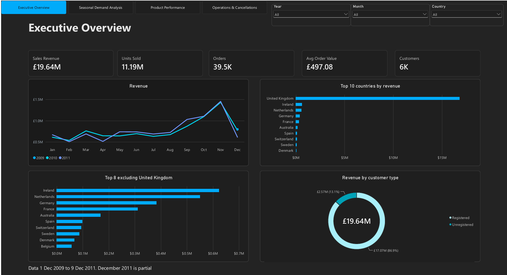
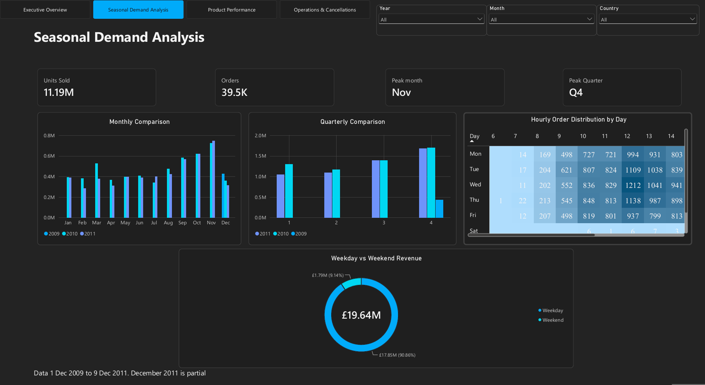
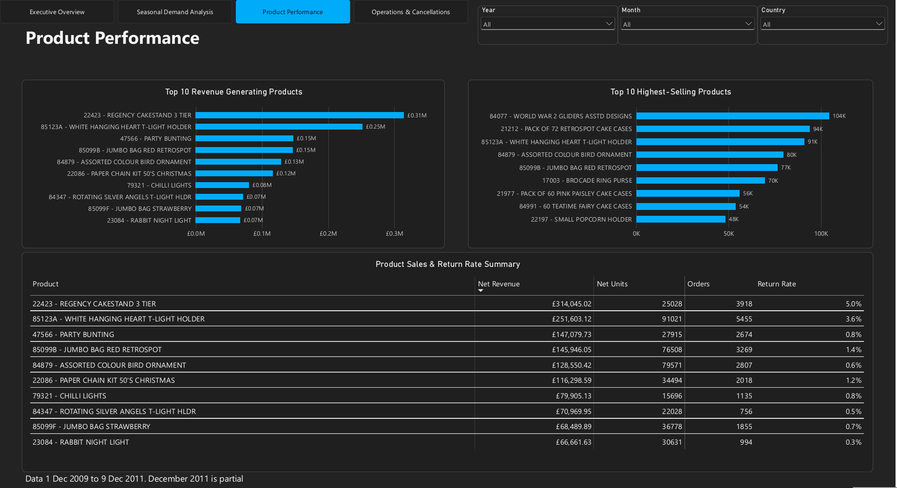
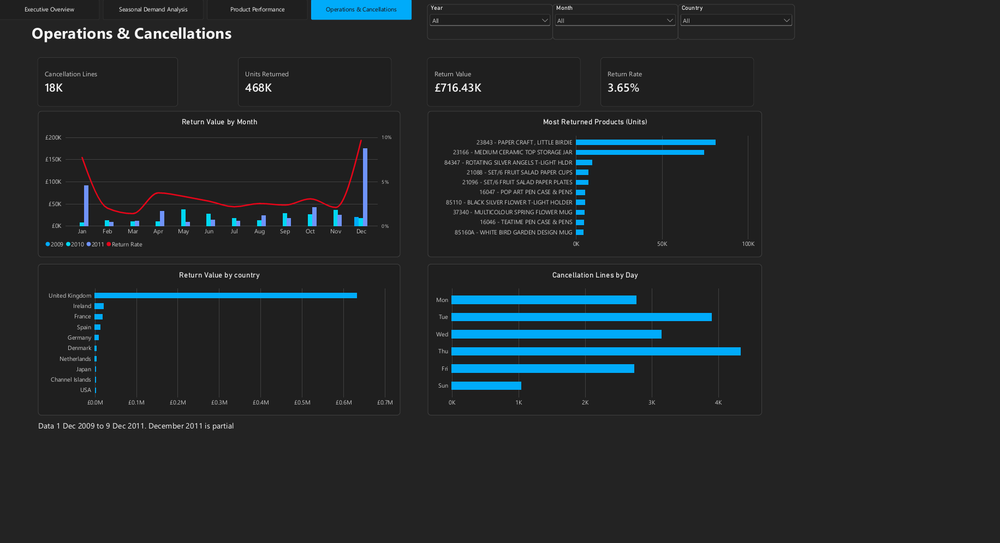

# Online Retail II: End-to-End Analytics Project

**SQL · Python · Power BI**

I took 1M+ rows of raw UK online-retail transactions and built the whole pipeline: cleaning and validation in MySQL, an ETL step in Python, and a four-page Power BI dashboard with findings and recommendations.

## What I did

- Cleaned two raw yearly sheets: duplicates, blanks, bad dates, a year overlap, and missing customer IDs.
- Built a validated SQL database with every row labelled (sale, cancellation, fee, adjustment).
- Exported the result with Python and modelled it in Power BI with DAX measures.
- Designed a four-page, accessible dashboard and wrote down the business findings.

## Dashboard


| | |
|---|---|
|  |  |
|  |  |

## Key results

*Sales rows, 1 Dec 2009 to 9 Dec 2011. Currency assumed to be GBP.*

| Area | Finding |
|---|---|
| Size | £19.64M sales, 39,516 orders, 5,852 registered customers, average order £497 |
| Markets | The UK is 85.5% of sales. Ireland, the Netherlands and Germany lead the rest |
| Seasonality | Sales build from September and peak in November, at about £1.4M in both 2010 and 2011 |
| Timing | 78% of orders arrive between 10 am and 4 pm. Weekends bring only 9% of revenue |
| Products | Sales are spread widely. The top 10 products make 8% of net revenue |
| Returns | £716K returned (3.65% of sales). Two cancelled bulk orders are about a third of returned units |
| Customers | Guest checkouts (no customer ID) are 13% of revenue |

## Project flow

```mermaid
flowchart LR
    A["Raw Excel: 2 yearly sheets"] --> B["Inspect and clean"]
    B --> C["Cleaned CSV files"]
    C --> D["Python import"]
    D --> E[("MySQL staging tables")]
    E --> F["Stack and convert types"]
    F --> G["master_final: labelled rows and views"]
    G --> H["Python export to CSV"]
    H --> I["Power BI model and DAX"]
    I --> J["Four-page dashboard"]
```



## Where to look

| Time | Look at |
|---|---|
| 30 seconds | This page: results and screenshots |
| 5 minutes | `sql/03_clean_and_prepare.sql` and `sql/05_analysis_queries.sql` |
| 15 minutes | `docs/`: the cleaning log, the full step-by-step guide and lessons learned |

## Skills shown

| Skill | Where |
|---|---|
| Data cleaning and validation | `docs/01_data_cleaning_log.md`, `sql/04_validation_checks.sql` |
| SQL (joins, CTEs, window functions, views) | `sql/03`, `sql/05` |
| Python ETL | `python/` |
| DAX and data modelling | `powerbi/measures.dax` |
| Dashboard design and accessibility | Dashboard pages, `powerbi/Retail_Clean_Theme.json` |
| Problem solving | `docs/03_lessons_learned.md` |
| Business storytelling | Key results and recommendations on this page |

## Business recommendations

*Ideas to test, not proven results.*

1. Plan stock and staff for September to November.
2. Staff for weekdays between 10 am and 4 pm.
3. Grow non-UK markets (Ireland, the Netherlands, Germany).
4. Review bulk-order cancellations. Two orders made up a third of returned units.
5. Convert guest checkouts to registered customers, so they can be tracked.

## Limitations

- Data covers 1 Dec 2009 to 9 Dec 2011. **December 2011 is partial.**
- About 23% of rows have no customer ID, so customer analysis covers registered customers only.
- Revenue is gross sales unless marked "net" (sales minus cancellations).

## Repository structure

```
.
├── README.md
├── requirements.txt
├── sql/
│   ├── 01_create_staging.sql
│   ├── 02_stack_and_type.sql
│   ├── 03_clean_and_prepare.sql
│   ├── 04_validation_checks.sql
│   └── 05_analysis_queries.sql
├── python/
│   ├── 01_import_csv_to_mysql.py
│   └── 02_export_master_final.py
├── powerbi/
│   ├── measures.dax
│   └── Retail_Clean_Theme.json
├── docs/
│   ├── 01_data_cleaning_log.md
│   ├── 02_step_by_step_guide.md
│   └── 03_lessons_learned.md
├── data/
│   └── sample_master_final_5k.csv
└── images/
```

## Run it

Full instructions are in [`docs/02_step_by_step_guide.md`](docs/02_step_by_step_guide.md). In short:

```bash
pip install -r requirements.txt
# run sql/01, then python/01_import_csv_to_mysql.py, then sql/02 to sql/05
python python/02_export_master_final.py
```

## Data

*Online Retail II*, UCI Machine Learning Repository. Check the licence on the dataset page and credit the source. The full files are not in this repo. A 5,000-row sample of the final table is in `data/`.

## Author

**[Your name]** · [LinkedIn](https://www.linkedin.com/) · [Portfolio](https://)
